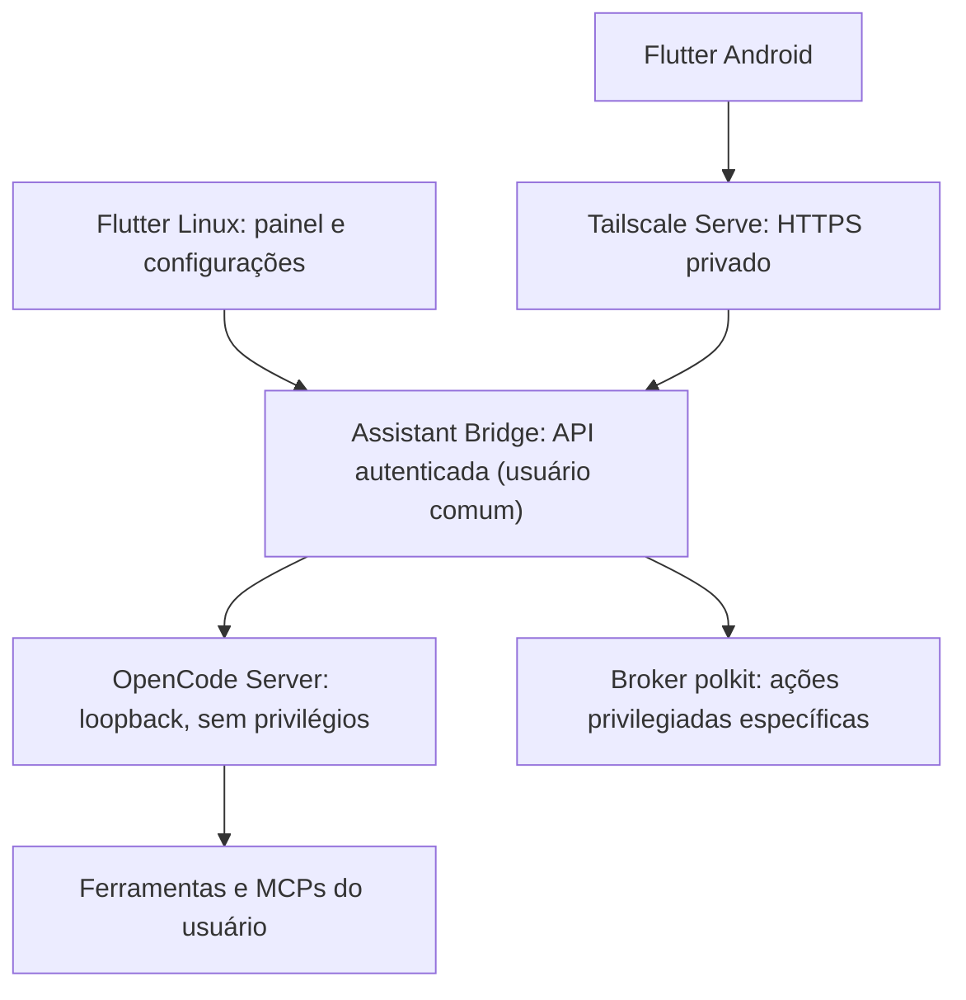

# OpenCode Assistant

Assistente pessoal e de desenvolvimento para **Linux (Fedora/GNOME)** e **Android**, com interface rápida em Flutter e execução das tarefas no computador por meio do OpenCode.

> **Estado:** planejamento. Não existe implementação funcional neste repositório. A stack está proposta e será validada nas issues iniciais.

## Visão

- No Linux: atalho do sistema abre um painel compacto, focado na entrada de texto ou voz; `Esc` fecha, tarefas continuam em segundo plano.
- No Android: aplicativo Flutter conversa com o assistente hospedado no PC, consulta andamento e solicita ações.
- Um backend local **Assistant Bridge** conversa com o OpenCode; o app nunca chama o shell do PC diretamente.
- Dois contextos: **Assistente pessoal** (conversa sem projeto) e **Desenvolvimento** (sessões vinculadas a projetos).
- Respostas em streaming, histórico compartilhado, notificações, temas claro/escuro e i18n pt-BR/en/es.
- Voz por push-to-talk primeiro; conversação contínua é recurso posterior e opcional.

## Arquitetura proposta

- **Interface:** Flutter/Dart para Linux e Android, Material 3 adaptado à estética Adwaita.
- **Bridge:** Node.js/TypeScript com SDK oficial do OpenCode **na versão efetivamente compatível**, API própria pequena, eventos por SSE ou WebSocket e serviço `systemd --user`. A versão da API/SDK deve ser validada antes de implementar; OpenCode passa por alterações incompatíveis.
- **OpenCode:** processo sob o usuário normal, acessível exclusivamente em `127.0.0.1`; sessões, modelos, agentes, permissões, mensagens e execução continuam sob responsabilidade do OpenCode.
- **Acesso externo:** Tailscale Serve por HTTPS na rede privada do usuário; nunca abrir OpenCode ou Bridge diretamente na internet, nem usar Tailscale Funnel por padrão.
- **Ações root:** broker separado, com API de operações explicitamente permitidas, validação rígida dos argumentos, PolicyKit (polkit), auditoria e revogação. **Nenhum agente recebe senha de sudo, root shell genérico ou permissão NOPASSWD irrestrita.**

Detalhes: [Arquitetura](.agents/ARCHITECTURE.md), [Segurança](.agents/SECURITY.md), [Contrato de API](.agents/API_CONTRACT.md).

## Escopo do MVP

1. Backend local sem root conectado ao OpenCode e capaz de listar/criar sessões, enviar mensagens, receber streaming e cancelar tarefas.
2. App Flutter no Fedora com painel rápido, histórico mínimo e configurações de conexão.
3. Perfis Assistente/Desenvolvimento, permissões e confirmação de tarefas sensíveis.
4. Serviço persistente e empacotamento de desenvolvimento.

**Fases seguintes:** cliente Android, pareamento por dispositivo, acesso remoto Tailscale, voz, broker privilegiado com operações autorizadas, anexos, notificações e pacotes de distribuição.

## Como contribuir

Antes de qualquer código, leia [AGENTS.md](AGENTS.md), [decisões](.agents/DECISIONS.md), [segurança](.agents/SECURITY.md) e [roadmap](.agents/ROADMAP.md). Cada funcionalidade deve nascer de uma issue e declarar critérios de aceite e dependências.

## Desenvolvimento

Ainda não existem comandos de build ou instalação: serão documentados após a criação do scaffold. Não coloque chaves, senhas, tokens ou arquivos de configuração pessoal no Git. Para uso real, a instalação deve exigir pareamento explícito e permanecer privada por padrão.

## Referências técnicas

- [OpenCode Server](https://opencode.ai/docs/server/)
- [SDK do OpenCode](https://opencode.ai/docs/sdk/)
- [Flutter para Linux](https://docs.flutter.dev/platform-integration/desktop)
- [Tailscale Serve](https://tailscale.com/docs/reference/tailscale-cli/serve)
- [polkit](https://polkit.pages.freedesktop.org/polkit/)
